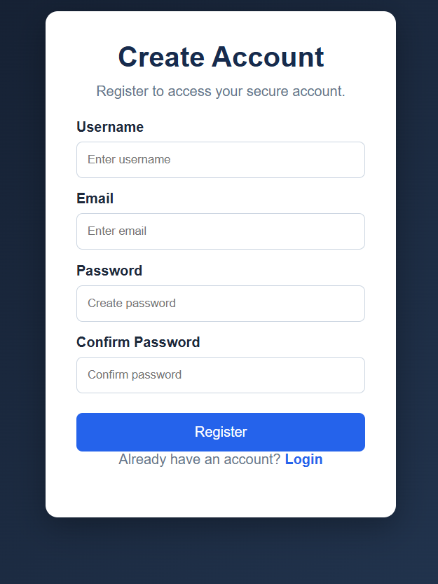
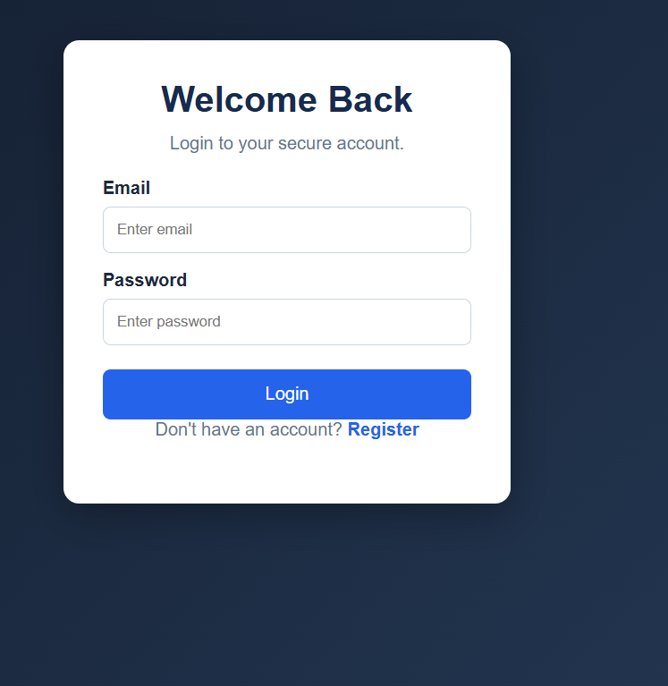
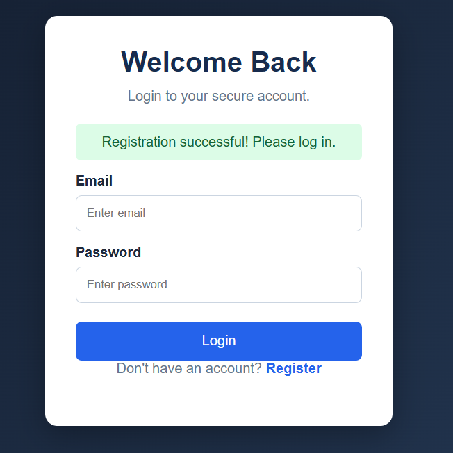
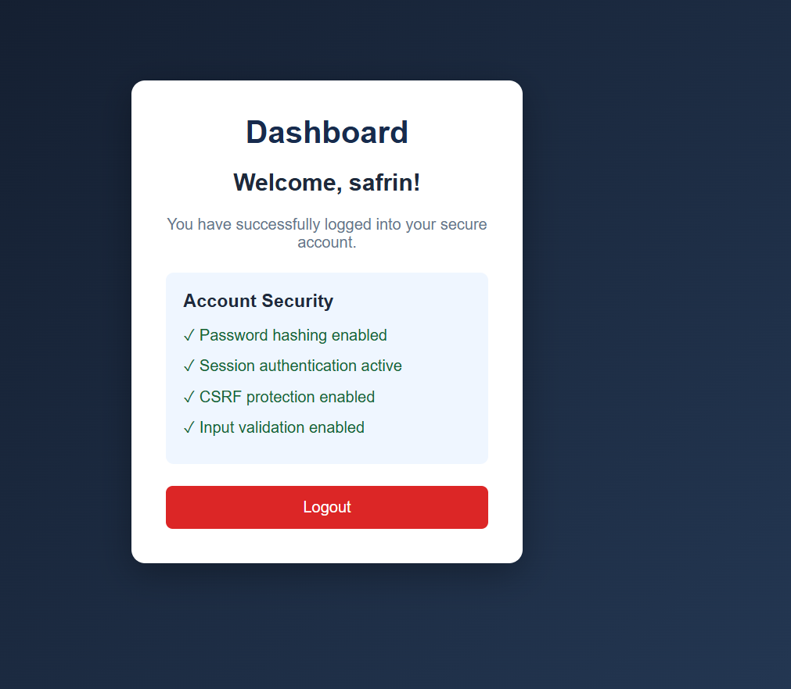
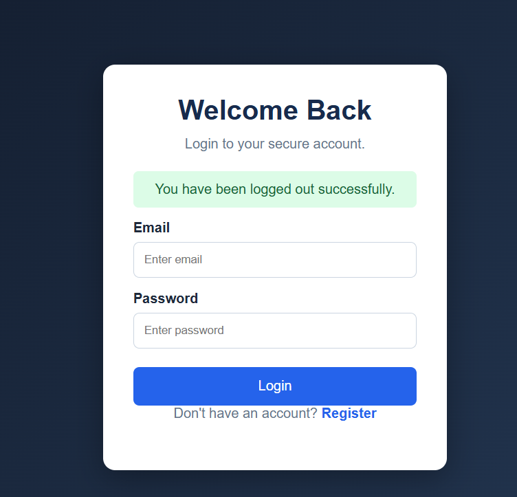

# 🔐 Secure Login System

A secure user authentication web application developed using Python Flask. This project provides user registration, login authentication, password hashing, session management and protection against common web security attacks.

## 📌 Project Overview

The Secure Login System is designed to protect user accounts through secure authentication practices. It allows users to create accounts, log in using their credentials, access a protected dashboard and securely log out.

Passwords are stored as bcrypt hashes instead of plain text, helping protect sensitive user credentials.

## ✨ Features

- **User Registration:** Create an account using a username, email and password.
- **Secure Login:** Authenticate users using registered credentials.
- **Password Hashing:** Uses bcrypt to securely hash passwords.
- **SQLite Database:** Stores user account information.
- **Session Management:** Maintains authenticated user sessions.
- **Logout Functionality:** Clears the user's session upon logout.
- **CSRF Protection:** Protects forms against Cross-Site Request Forgery.
- **Input Validation:** Validates user-provided information.
- **SQL Injection Protection:** Uses parameterized SQL queries.
- **Rate Limiting:** Restricts repeated login attempts.
- **Protected Dashboard:** Allows access only to authenticated users.

## 🛠️ Technologies Used

| Technology | Purpose |
|---|---|
| Python | Backend programming |
| Flask | Web application framework |
| SQLite | Database |
| HTML5 | Web page structure |
| CSS3 | Styling and design |
| Bcrypt | Password hashing |
| Flask-WTF | CSRF protection |
| Flask-Limiter | Rate limiting |

## 📂 Project Structure

```text
Secure-Login-System/
│
├── app.py
├── requirements.txt
├── .gitignore
├── README.md
│
├── templates/
│   ├── login.html
│   ├── register.html
│   └── dashboard.html
│
├── static/
│   └── css/
│       └── style.css
│
└── screenshots/
    ├── 01-registration.png
    ├── 02-login.png
    ├── 03-registration-success.png
    ├── 04-dashboard.png
    ├── 05-logout.png
    └── 06-invalid-email-or-password.png
```

## ⚙️ Installation and Setup

### 1. Clone the repository

```bash
git clone YOUR_GITHUB_REPOSITORY_URL
```

### 2. Navigate to the project directory

```bash
cd Secure-Login-System
```

### 3. Create a virtual environment

```bash
python -m venv venv
```

### 4. Activate the virtual environment

**Windows:**

```bash
venv\Scripts\activate
```

### 5. Install dependencies

```bash
pip install -r requirements.txt
```

### 6. Configure environment variables

Create a `.env` file in the root project directory.

Add a securely generated secret key:

```env
SECRET_KEY=your_generated_secret_key
```

Never share or upload your actual `.env` file.

### 7. Run the application

```bash
python app.py
```

### 8. Open the application

Visit:

```text
http://127.0.0.1:5000
```

## 📸 Application Screenshots

### 1. User Registration


### 2. User Login


### 3. Successful Registration


### 4. User Dashboard


### 5. Logout


### 6. Invalid Credentials


## 🔒 Security Implementations

- Passwords are stored using bcrypt hashing.
- Parameterized SQL queries help prevent SQL injection.
- CSRF tokens protect form submissions.
- Flask sessions manage authenticated access.
- Rate limiting helps prevent repeated login attempts.
- Input validation rejects invalid user information.
- Protected routes prevent unauthorized dashboard access.

## 🎯 Expected Outcome

A functional secure authentication web application that demonstrates essential web development and cybersecurity concepts, including password security, database integration, session handling and protection against common web attacks.

## 👩‍💻 Author

Developed as a cybersecurity and web development project.

## 📄 License

This project is available for educational and learning purposes.
